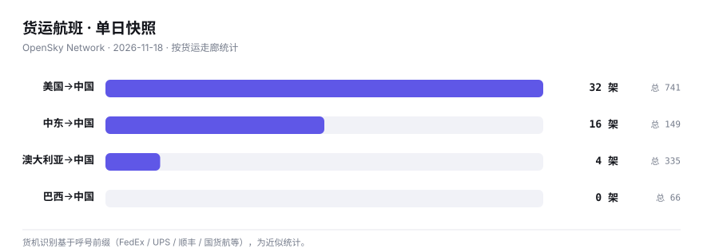
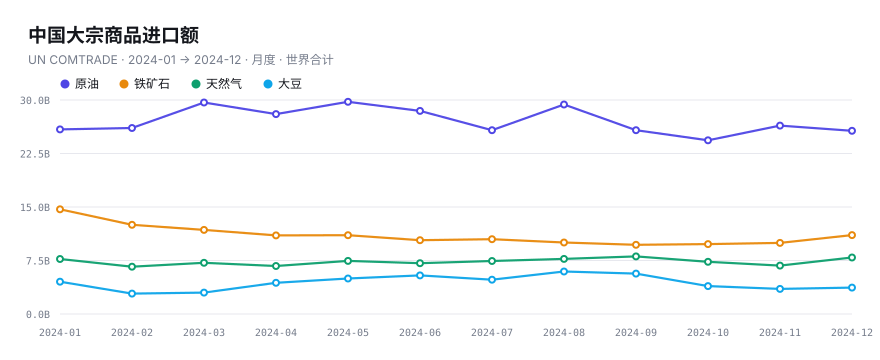

# 📡 open-signals

> 用公开数据，观察大宗商品的“物理侧”信号。

价格会被预期和情绪拉动，但**装船、到港、报关**不会说谎。这个仓库把两类公开数据整理成结构化的 JSON 时间序列：

- **货运航班**（OpenSky Network）——主要货运走廊的实时航班快照
- **中国进口**（UN COMTRADE）——粮食 / 能源 / 矿产的月度进口额

零依赖、只用 Python 标准库，每天由 GitHub Actions 自动采集。





---

## 为什么做这个

做商品研究时，新闻和价格是“结果”，而航运和报关是“过程”。过程数据更慢，但更少骗人。

这个仓库不预测价格，只负责**把过程数据变成可引用的时间序列**，方便：

- 观察某条走廊的货运频次是否异常（比如中东→中国突然翻倍）
- 对比月度进口额与价格走势是否背离（量价背离）
- 给其他模型 / 看板提供干净的输入

---

## 数据

### 1. 货运航班（OpenSky Network）

按 4 条走廊的经纬度框，抓取**当前时刻**在该空域内的航班，并按呼号前缀识别货机。

| 走廊 | 覆盖范围 | 对应商品 |
|:---|:---|:---|
| 中东→中国 | 波斯湾 / 中东 | 原油、天然气 |
| 巴西→中国 | 巴西东南部 | 大豆、铁矿石 |
| 美国→中国 | 美国本土 | 农产品、芯片设备 |
| 澳大利亚→中国 | 澳洲大陆 | 铁矿石、煤炭 |

快照示例（2026-11-18）：

| 走廊 | 货机 | 空域内航班总数 |
|:---|---:|---:|
| 美国→中国 | 32 | 741 |
| 中东→中国 | 16 | 149 |
| 澳大利亚→中国 | 4 | 335 |
| 巴西→中国 | 0 | 66 |

### 2. 中国进口（UN COMTRADE）

按 HS 编码抓取中国从“世界”及主要伙伴的月度进口额。

| HS | 商品 | 板块 | 2024-12 进口额 |
|:---|:---|:---|---:|
| 2709 | 原油 | 能源 | $25.7B |
| 2601 | 铁矿石 | 矿产 | $11.1B |
| 2711 | 天然气 | 能源 | $7.9B |
| 1201 | 大豆 | 粮食 | $3.7B |
| 2701 | 煤炭 | 能源 | $3.4B |
| 1006 | 稻米 | 粮食 | $0.22B |
| 1005 | 玉米 | 粮食 | $0.09B |
| 1001 | 小麦 | 粮食 | $0.04B |

---

## 数据结构

```
data/
├── comtrade/
│   ├── latest_summary.json          # 8 个商品的月度金额趋势
│   └── 2024/12/31/202412.json       # 单月明细（含伙伴国）
└── opensky/
    └── 2026/11/18/20261118.json     # 单日快照
```

**航班快照**

```json
{
  "date": "20261118",
  "timestamp": "2026-11-18T07:12:03",
  "routes": {
    "中东→中国": { "total_flights": 149, "cargo_flights": 16, "desc": "能源/商品相关" }
  },
  "airports": {
    "PVG": { "name": "上海浦东", "country": "CN", "total_flights": 0, "cargo_flights": 0 }
  }
}
```

**进口明细**

```json
{
  "0_2709": {
    "period": "202412",
    "commodity": "原油",
    "hs_code": "2709",
    "sector": "能源",
    "partner": "世界",
    "partner_code": "0",
    "import_value_usd": 25690000000
  }
}
```

---

## 本地运行

不需要任何密钥，也不需要安装依赖（Python 3.9+）。

```bash
# 1. 抓一份中国进口快照（默认最近 12 个有数据的月份）
python3 scripts/snapshot_comtrade.py --months 12

# 2. 抓一次航班快照（--local 表示只写本地，不推送到私有仓库）
python3 opensky/fetch_opensky.py --local

# 3. 重新生成 README 里的图表
python3 scripts/render_charts.py
```

只想复现 2024 年的话：

```bash
python3 scripts/snapshot_comtrade.py --periods 202401,...,202412 --no-partners
```

> 两个数据源都有速率限制，脚本里已经带了 429 退避；间隔不要调得太小。

## 自动化

`.github/workflows/collect.yml` 每天 **06:00 UTC（北京 14:00）** 运行：

1. 采集 COMTRADE 月度数据
2. 采集 OpenSky 航班快照
3. 写入私有数据仓库 `Central-Bank`（本仓库保留少量样本）

---

## 已知局限（请先读这段再用数据）

1. **航班数是瞬时快照**，不是当天起降总量。它只反映“抓取那一刻该空域有多少架飞机”，适合看**相对变化**，不能直接当作贸易量。
2. **美国走廊的“总航班”明显偏大**（741 vs 中东 149），因为 bbox 覆盖了整个美国本土及周边，包含大量国内航班和过境航班。跨走廊比较请优先看 `cargo_flights`。
3. **货机识别是启发式的**：按呼号前缀匹配 FedEx / UPS / 顺丰 / 国货航等，包机、新航司、军运会漏计。
4. **COMTRADE 有发布延迟**（通常 1–2 个月），且 preview 接口只稳定返回金额，`net_weight_kg` 可能为 0。
5. **单日样本噪声大**：建议看 7 日均值或更长窗口，而不是单看某一天。

---

## 路线图

- [ ] 航班数据做 7 日滚动均值，降低单日噪声
- [ ] 支持 CSV 导出，方便丢进 Excel / pandas
- [ ] 把 `docs/*.svg` 改为随 CI 自动更新
- [ ] 增加“量价背离”示例分析

---

## 许可与引用

- **代码**：[MIT](LICENSE)
- **数据**：版权归原始来源所有，使用请遵守其条款并署名
  - 航班数据：[OpenSky Network](https://opensky-network.org/)（学术/非商业使用请遵守其 [Terms](https://opensky-network.org/about/terms-of-use)）
  - 贸易数据：[UN COMTRADE](https://comtradeplus.un.org/)（引用时请注明 UN Comtrade Database）

如果这个仓库对你有帮助，欢迎 star ⭐，或开 issue 告诉我你想看哪条走廊 / 哪个商品。
